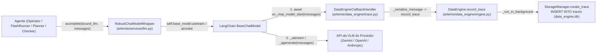

# Persistência do Payload de Prompt da LLM em `data_engine.db` (Tabela `traces`)

No ARTEMIS, o payload do prompt salvo na tabela `traces` do banco `data_engine.db` é capturado **dentro da fronteira de execução do modelo no LangChain**, imediatamente antes de o chat model subjacente disparar a requisição para a API do provedor — e não em um mock externo ou em um gancho prévio de montagem.

---

## 1. Caminhos Exatos de Arquivos e Números de Linha

| Etapa | Arquivo e Linhas | Símbolo / Papel |
| :--- | :--- | :--- |
| **1. Anexação do Callback de Trace à LLM** | `artemis/services/llm.py` ([llm.py](file:///C:/Users/rvtc/Documents/dev/artemis/artemis/services/llm.py#L1006-L1039)) | `_get_llm` (`L1033-L1036`): anexa `DataEngineCallbackHandler(ctx)` ao `raw_model` via `.with_config(callbacks=[handler])` e o envolve em `RobustChatModelWrapper`. |
| **2. Despacho para o Modelo do Provedor** | `artemis/services/llm.py` ([llm.py](file:///C:/Users/rvtc/Documents/dev/artemis/artemis/services/llm.py#L647-L810)) | `RobustChatModelWrapper.ainvoke` (`L647-L656`), `complete` / `_complete_attempt` (`L658-L753`) e `acomplete` (`L784-L810`) encaminham o objeto `messages` do chamador sem alterações para `self.base_model.astream` (`L707`) ou `self.base_model.ainvoke` (`L650`, `L702`, `L748`, `L752`). |
| **3. Captura do Prompt Exato Antes da Chamada à API** | `artemis/data_engine/trace.py` ([trace.py](file:///C:/Users/rvtc/Documents/dev/artemis/artemis/data_engine/trace.py#L221-L252)) e ([trace.py](file:///C:/Users/rvtc/Documents/dev/artemis/artemis/data_engine/trace.py#L407-L412)) | `DataEngineCallbackHandler.on_chat_model_start` (`L221-L252`) e `_serialize_message` (`L407-L412`): acionado pelo LangChain (`BaseChatModel.astream` / `agenerate`) de forma síncrona antes de `_astream` / `_agenerate` chamar a API da VLM; extrai `msg.type`, `msg.content` e `msg.additional_kwargs` literalmente (sem truncamento por `smart_serialize`) e chama `record_trace` (`status="running"`). `on_llm_end` (`L261-L332`) e `on_llm_error` (`L373-L405`) reanexam o mesmo `messages` junto de `"response"` / `"error"`. |
| **4. Enfileiramento do `TraceRecord` no DataEngine** | `artemis/data_engine/engine.py` ([engine.py](file:///C:/Users/rvtc/Documents/dev/artemis/artemis/data_engine/engine.py#L1096-L1146)) | `DataEngine.record_trace` (`L1121-L1134`): cria `TraceRecord(..., payload=payload)` e delega `self.storage.create_trace` via `_run_in_background` (`L1299-L1321`). O caminho `data_engine.db` é configurado em `DataEngine.__init__` (`L401, L405`, resolvido por `get_data_engine_db_path` em [paths.py](file:///C:/Users/rvtc/Documents/dev/artemis/artemis/config/paths.py#L120-L122)). |
| **5. `INSERT INTO traces` no SQLite** | `artemis/data_engine/storage.py` ([storage.py](file:///C:/Users/rvtc/Documents/dev/artemis/artemis/data_engine/storage.py#L929-L964)) | `StorageManager.create_trace` (`L934-L961`): executa `INSERT INTO traces (...) ON CONFLICT(trace_id) DO UPDATE SET ...` serializando `trace.payload` com `json.dumps(trace.payload, cls=SafeJSONEncoder)` (`L961`). |

---

## 2. Fluxo Ponta a Ponta da Chamada



---

## 3. Trechos de Código

### A. Vinculação do callback e envio direto de `messages` para a LLM (`artemis/services/llm.py`)

Em [`artemis/services/llm.py`](file:///C:/Users/rvtc/Documents/dev/artemis/artemis/services/llm.py#L1031-L1036):

```python
    raw_model = ModelFactory.get_model(endpoint)

    handler = DataEngineCallbackHandler(ctx)
    bound_model = raw_model.with_config(callbacks=[handler])

    return RobustChatModelWrapper(bound_model, ctx, endpoint=endpoint)  # type: ignore
```

Durante a execução em `RobustChatModelWrapper._complete_attempt` ([`artemis/services/llm.py`](file:///C:/Users/rvtc/Documents/dev/artemis/artemis/services/llm.py#L704-L707)), `self.base_model` (o `RunnableBinding` do LangChain que envolve o chat model do provedor) é invocado diretamente com os argumentos `*args, **kwargs` (`messages`) do chamador, sem modificar `messages`:

```python
        async for chunk in self.base_model.astream(*args, **kwargs):
```

### B. Interceptação e serialização de `messages` no hook de início do LangChain (`artemis/data_engine/trace.py`)

Em [`artemis/data_engine/trace.py`](file:///C:/Users/rvtc/Documents/dev/artemis/artemis/data_engine/trace.py#L221-L252) e [`L407-L412`](file:///C:/Users/rvtc/Documents/dev/artemis/artemis/data_engine/trace.py#L407-L412):

```python
    def on_chat_model_start(
        self,
        serialized: dict[str, Any],
        messages: list[list[BaseMessage]],
        *,
        run_id: uuid.UUID,
        parent_run_id: uuid.UUID | None = None,
        **kwargs: Any,
    ) -> Any:
        """Run when Chat Model starts running."""
        if self.ctx.data_engine:
            flat_messages = []
            if messages:
                for msg in messages[0]:
                    flat_messages.append(self._serialize_message(msg))

            name = serialized.get("name") or "llm"
            self.running_spans[run_id] = {
                "messages": flat_messages,
                "name": name,
                "start_time": time.time(),
            }

            self.ctx.data_engine.record_trace(
                type="llm_call",
                name=name,
                payload={"messages": flat_messages},
                trace_id=run_id,
                parent_trace_id=self._resolve_parent_id(parent_run_id, kwargs),
                status="running",
                step_id=self._current_step_id(),
            )
```

```python
    def _serialize_message(self, msg: BaseMessage) -> dict[str, Any]:
        return {
            "type": msg.type,
            "content": msg.content,
            "additional_kwargs": msg.additional_kwargs,
        }
```

Ao término da chamada, `on_llm_end` ([`artemis/data_engine/trace.py`](file:///C:/Users/rvtc/Documents/dev/artemis/artemis/data_engine/trace.py#L286-L295)) retira exatamente essa lista `messages` de `self.running_spans[run_id]` e registra o trace finalizado sob o mesmo `trace_id=run_id`:

```python
            span_data = self.running_spans.pop(run_id, {})
            messages = span_data.get("messages", [])
            ...
            payload = {"response": flat_generations}
            if messages:
                payload["messages"] = messages
```

### C. Construção do `TraceRecord` e execução do `INSERT INTO traces` (`artemis/data_engine/engine.py` e `artemis/data_engine/storage.py`)

Em [`artemis/data_engine/engine.py`](file:///C:/Users/rvtc/Documents/dev/artemis/artemis/data_engine/engine.py#L1121-L1135):

```python
        trace = TraceRecord(
            trace_id=trace_id,
            session_id=self.current_session_id,
            step_id=step_id,
            parent_trace_id=parent_trace_id,
            type=type,
            name=name,
            timestamp=trace_ts,
            duration=duration,
            status=status,
            payload=payload,
        )

        self._run_in_background(self.storage.create_trace, trace)
```

Em [`artemis/data_engine/storage.py`](file:///C:/Users/rvtc/Documents/dev/artemis/artemis/data_engine/storage.py#L929-L964):

```python
    def create_trace(self, trace: TraceRecord):
        """Insert or update a trace record (handles out-of-order writes and preserves start timestamps)."""
        with self._get_connection() as conn:
            conn.execute(
                """
                INSERT INTO traces (
                    trace_id, session_id, step_id, parent_trace_id, type, name,
                    timestamp, duration, status, payload
                )
                VALUES (?, ?, ?, ?, ?, ?, ?, ?, ?, ?)
                ON CONFLICT(trace_id) DO UPDATE SET
                    status = CASE 
                        WHEN excluded.status = 'running' AND traces.status IN ('success', 'failed') THEN traces.status
                        ELSE excluded.status
                    END,
                    duration = COALESCE(excluded.duration, traces.duration),
                    timestamp = MIN(traces.timestamp, excluded.timestamp),
                    payload = CASE
                        WHEN excluded.status = 'running' AND traces.status IN ('success', 'failed') THEN traces.payload
                        ELSE excluded.payload
                    END
                """,
                (
                    str(trace.trace_id),
                    str(trace.session_id),
                    str(trace.step_id) if trace.step_id else None,
                    str(trace.parent_trace_id) if trace.parent_trace_id else None,
                    trace.type,
                    trace.name,
                    trace.timestamp,
                    trace.duration,
                    trace.status,
                    json.dumps(trace.payload, cls=SafeJSONEncoder),
                ),
            )
            conn.commit()
```

---

## 4. Explicação Arquitetural para Defesa Perante a Banca

1. **Fonte Única de Verdade no Caminho de Chamada da LLM**: Os agentes do caminho universal (`Operator` em [`operator.py`](file:///C:/Users/rvtc/Documents/dev/artemis/artemis/agents/operator/operator.py#L506), `FlashRunner` em [`runner.py`](file:///C:/Users/rvtc/Documents/dev/artemis/artemis/agents/flash/runner.py#L986-L996), `Planner` em [`planner.py`](file:///C:/Users/rvtc/Documents/dev/artemis/artemis/agents/planner/planner.py#L322), `Checker` em [`checker.py`](file:///C:/Users/rvtc/Documents/dev/artemis/artemis/agents/checker/checker.py#L493), etc.) obtêm seu modelo por meio de `get_llm()` (`artemis/services/llm.py`), que vincula `DataEngineCallbackHandler` à instância do chat model via `.with_config(callbacks=[handler])`. Os chamadores nunca montam uma "cópia paralela" apenas para log — eles passam uma única lista `messages` para `acomplete(...)` / `ainvoke(...)`.
2. **Captura Síncrona Antes da Transmissão ao Provedor**: Dentro de `BaseChatModel.astream` e `BaseChatModel.agenerate` no LangChain, o framework aguarda (`await`) a execução de `callback_manager.on_chat_model_start(self._serialized, [_format_for_tracing(messages)], ...)` **antes** de chamar `self._astream(input_messages, ...)` ou `self._agenerate_with_cache(...)` para enviar a requisição à API da VLM.
3. **Conteúdo Byte a Byte Idêntico, Sem Truncamento nem Placeholders**:
   - A inspeção de `langchain_core.language_models.chat_models` confirma que, para as mensagens multimodais do ARTEMIS — blocos `{"type": "text", ...}` e blocos no formato OpenAI `{"type": "image_url", "image_url": {"url": "data:image/jpeg;base64,..."}}` (usados em [`prompts.py`](file:///C:/Users/rvtc/Documents/dev/artemis/artemis/agents/operator/prompts.py#L401-L406), [`runner.py`](file:///C:/Users/rvtc/Documents/dev/artemis/artemis/agents/flash/runner.py#L390-L392), [`planner.py`](file:///C:/Users/rvtc/Documents/dev/artemis/artemis/agents/planner/planner.py#L282-L287), etc.) — tanto `_format_for_tracing(messages)` quanto `_normalize_messages(messages)` retornam exatamente os mesmos objetos `BaseMessage`, sem reescrevê-los nem copiá-los.
   - Diferentemente dos decoradores `@trace` de ferramentas/agentes ([`trace.py`](file:///C:/Users/rvtc/Documents/dev/artemis/artemis/data_engine/trace.py#L471-L485)), que passam valores por `smart_serialize()` ([`L38-L72`](file:///C:/Users/rvtc/Documents/dev/artemis/artemis/data_engine/trace.py#L38-L72)) e substituem payloads longos/base64 por placeholders como `<ImageRef: ...>` ou `<Massive String ...>`, o método `DataEngineCallbackHandler._serialize_message` ([`L407-L412`](file:///C:/Users/rvtc/Documents/dev/artemis/artemis/data_engine/trace.py#L407-L412)) copia `msg.type`, `msg.content` e `msg.additional_kwargs` diretamente.
   - `SafeJSONEncoder` ([`storage.py`](file:///C:/Users/rvtc/Documents/dev/artemis/artemis/data_engine/storage.py#L51-L58)) resume apenas objetos Python do tipo `bytes`; como os blocos de imagem multimodais do ARTEMIS usam strings base64 (`"data:image/jpeg;base64,..."`), `json.dumps(trace.payload, cls=SafeJSONEncoder)` grava o payload completo e inalterado do prompt literalmente na coluna `traces.payload` do banco `data_engine.db`.
   - Mesmo quando o `ScrubEdgeCompressor` ([`context_compressor.py`](file:///C:/Users/rvtc/Documents/dev/artemis/artemis/agents/flash/context_compressor.py#L370-L408)) comprime turnos antigos em etapas posteriores da sessão, ele constrói uma nova lista `new_blocks` e reatribui `msg.content = new_blocks` (`L408`), sem mutar no lugar a lista capturada anteriormente.

---

## 5. Ressalvas Importantes de Escopo (Para Rigor Científico na Defesa)

- **Serialização de Transporte do Provedor e Schemas de Ferramentas**: O adaptador do provedor no LangChain (por exemplo, `ChatGoogleGenerativeAI._prepare_request`) converte a lista de `BaseMessage` para o formato de protocolo do SDK do provedor (ex.: `Content` e `system_instruction` em `google.genai`) *após* `on_chat_model_start`. Além disso, as declarações de ferramentas vinculadas via `.bind_tools()` trafegam em `invocation_params` (`kwargs`), e não dentro de `payload["messages"]`.
- **Caminhos Nativos com `google-genai` Direto (Fora do LangChain)**: Dois caminhos especializados para Gemini nativo invocam `google.genai` diretamente, em vez de passarem pelo LangChain + `DataEngineCallbackHandler`:
  - [`native_runner.py`](file:///C:/Users/rvtc/Documents/dev/artemis/artemis/agents/explorer/native_runner.py#L479-L537) (Explorer nativo) registra um resumo via `TraceSpan` sem o prompt completo `contents` (enquanto [`universal_runner.py`](file:///C:/Users/rvtc/Documents/dev/artemis/artemis/agents/explorer/universal_runner.py#L91-L121) passa por `get_llm()`).
  - [`native_coordinator.py`](file:///C:/Users/rvtc/Documents/dev/artemis/artemis/agents/video_analyzer/native_coordinator.py#L232-L266) (Video Analyzer nativo) substitui `inline_data["data"]` por `"<image_bytes_sanitized>"` antes de chamar `record_trace` (enquanto [`universal_engine.py`](file:///C:/Users/rvtc/Documents/dev/artemis/artemis/agents/video_analyzer/universal_engine.py#L49-L87) e [`video_analyzer.py`](file:///C:/Users/rvtc/Documents/dev/artemis/artemis/agents/video_analyzer/video_analyzer.py#L216-L254) passam por `get_llm()`).
- **Trace Secundário de Resumo no `FlashRunner`**: `FlashRunner._record_llm_trace` ([`runner.py`](file:///C:/Users/rvtc/Documents/dev/artemis/artemis/agents/flash/runner.py#L552-L573)) grava um registro adicional `llm_call` chamado `"FlashRunner"` (apenas contagem de tokens e texto da resposta) *além* do registro completo `llm_call` (contendo `payload["messages"]`) já gravado pelo `DataEngineCallbackHandler` durante `_invoke_model` ([`L986-L996`](file:///C:/Users/rvtc/Documents/dev/artemis/artemis/agents/flash/runner.py#L986-L996)).
