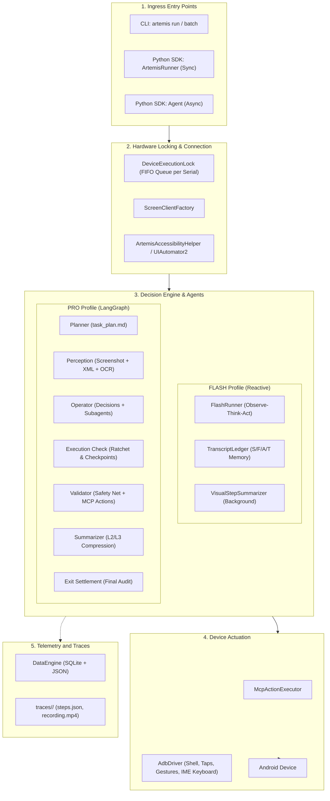

# ARTEMIS — Architecture, Data Flow, and Engineering Guide

This document provides an in-depth analysis of the internal architecture of the **ARTEMIS** (*Autonomous Multimodal Android Agent & Testing Framework*) repository. The purpose of this guide is to serve as a comprehensive technical reference for development, debugging, flow control, and system customization.

---

## Table of Contents

1. [Overview](#1-overview)
2. [End-to-End Architecture and Data Flow](#2-end-to-end-architecture-and-data-flow)
   - [2.1 Ingress Layers](#21-ingress-layers)
   - [2.2 Device Lock and Hardware Connection](#22-device-lock-and-hardware-connection)
   - [2.3 Execution Profiles: Flash vs. Pro](#23-execution-profiles-flash-vs-pro)
   - [2.4 State Machine and Context Memory](#24-state-machine-and-context-memory)
   - [2.5 In-Process MCP Actuation and Session](#25-in-process-mcp-actuation-and-session)
   - [2.6 Telemetry and Trace Persistence](#26-telemetry-and-trace-persistence)
3. [LLM/VLM Model Invocations and Routing](#3-llmvlm-model-invocations-and-routing)
   - [3.1 Granular Configuration (`config/artemis.jsonc`)](#31-granular-configuration-configartemisjsonc)
   - [3.2 Provider Router and Factory](#32-provider-router-and-factory)
   - [3.3 Resilience, Circuit Breaker, and Fallback](#33-resilience-circuit-breaker-and-fallback)
   - [3.4 Token Metering and Caching](#34-token-metering-and-caching)
4. [Image Capture, Resolution, and Quality](#4-image-capture-resolution-and-quality)
   - [4.1 Where Screenshots are Generated](#41-where-screenshots-are-generated)
   - [4.2 Formatting and Injection into the Multimodal Prompt](#42-formatting-and-injection-into-the-multimodal-prompt)
   - [4.3 Practical Guide to Adjusting Resolution and Compression](#43-practical-guide-to-adjusting-resolution-and-compression)
   - [4.4 Impact on the Coordinate System](#44-impact-on-the-coordinate-system)
5. [Flow Control and Execution Termination](#5-flow-control-and-execution-termination)
   - [5.1 Profile Selection (`flash` vs `pro`)](#51-profile-selection-flash-vs-pro)
   - [5.2 Turn Limits and Completion Criteria](#52-turn-limits-and-completion-criteria)
   - [5.3 Live Instruction Injection (`injected_instruction.json`)](#53-live-instruction-injection-injected_instructionjson)
   - [5.4 Audit and Verification System (`Checker` & Safety Net)](#54-audit-and-verification-system-checker--safety-net)
   - [5.5 Graceful Task Cancellation](#55-graceful-task-cancellation)
6. [Complete Directory Structure Mapping](#6-complete-directory-structure-mapping)
7. [Best Practices and Development Tips](#7-best-practices-and-development-tips)

---

## 1. Overview

**ARTEMIS** is a platform designed to execute everyday tasks and complex automated testing workflows on Android operating systems (physical devices and emulators), interpreting the screen visually and interacting with the graphical interface just like a human user.

The system integrates:
- **Comprehensive Multimodal Support**: Models such as Gemini (Google GenAI / Vertex AI), GPT-4o (OpenAI), Claude 3.5/3.7 (Anthropic), Grok (xAI), and local providers like Ollama and vLLM.
- **Direct In-Process Architecture**: Pure Python library with zero background daemons, zero open network ports, and zero JavaScript/Node dependencies.
- **First-Class Python SDK & CLI**: Synchronous context manager (`ArtemisRunner`), async `Agent`, and interactive terminal CLI (`artemis run`, `artemis batch`, `artemis doctor`, `artemis trace`, `artemis helper`).
- **Dual Operational Modes**: **Flash** Profile (ultra-fast reactive loop running at 3–5s per step) and **Pro** Profile (agent graph featuring dynamic planning, checkpoints, and failure recovery).

---

## 2. End-to-End Architecture and Data Flow



### 2.1 Ingress Layers
1. **CLI (`artemis run`, `artemis batch`)**: Parses arguments via `typer` in `artemis/interfaces/cli/commands/run.py` and triggers `execute_task()` directly in-process via `asyncio.run()`.
2. **Synchronous Python SDK (`ArtemisRunner`)**: Simple context manager in `artemis/runner.py` for scripts, testing frameworks (`pytest`), and assertions with optional Pydantic structured output.
3. **Asynchronous Python SDK (`artemis.sdk.Agent`)**: Full async lifecycle (`init()`, `run_task()`, `clean()`) for advanced pipelines and custom event loops.

### 2.2 Device Lock and Hardware Connection
- **`DeviceExecutionLock` (`artemis/runtime/device_lock.py`)**: Implements a strict global FIFO queue indexed by ADB device serial numbers. This prevents concurrent tasks from dispatching conflicting touch inputs to the same screen.
- **Secure Lock Detection**: The agent inspects device lock states via `dumpsys trust`. If the device is protected by a PIN, password, or biometric pattern, execution is aborted to avoid dangerous or unauthorized credential guessing.
- **`ScreenClientFactory` (`artemis/clients/screen_client_factory.py`)**: Connects by default to the on-device `ArtemisAccessibilityHelper` APK (HTTP port mapped over ADB reverse/forward) for instant UI hierarchy dumps and unified screenshots. If unavailable, it gracefully falls back to `UIAutomator2`.

### 2.3 Execution Profiles: Flash vs. Pro
Execution branches within `AgentBase._run_task()`:
- **Flash (`FlashRunner`)**:
  - Implemented in `artemis/agents/flash/runner.py`.
  - Executes a linear reactive loop: `Observe -> Think -> Act`.
  - Conversation history is managed by `TranscriptLedger` with asynchronous background screenshot compression.
- **Pro (`LangGraph`)**:
  - Implemented in `artemis/graph/graph.py`.
  - Builds an explicit state machine with specialized nodes (`planner`, `perception`, `operator`, `execution_check`, `validator`, `summarizer`, `exit_settlement`).

### 2.4 State Machine and Context Memory
In the Pro profile, execution data travels through the Pydantic `State` model (`artemis/graph/state.py`):
- `initial_goal`: Original user objective.
- `latest_screenshot`, `operator_raw_data`, `latest_ui_hierarchy`: Current visual and structural perception of the screen.
- `structured_decisions`: Structured JSON action decisions made by the Operator.
- `last_execution_result`: Execution feedback returned by the Validator.
- `operator_feedback`: Cumulative feedback from checks and audits.
- `injected_instruction`: Dynamic instructions sent live by the user.

`TranscriptLedger` partitions messages into 4 logical regions:
1. **Region S (Stable Prefix)**: Static system instructions, identical across the entire session (enables provider prompt caching).
2. **Region F (Frozen History)**: Compacted, immutable history partitioned into epochs and milestones.
3. **Region A (Active Window)**: Recent turns and tool interactions within immediate focus.
4. **Region T (Current Tail)**: Current observation block (`# CURRENT OBSERVATION [T+mm:ss]`) containing the latest screenshot and UI hierarchy.

Context compression occurs across 3 progressive tiers:
- **L1 (Text Edge)**: Strips ephemeral UI listings and turn notifications once a step concludes.
- **L2 (Image Edge)**: Replaces historical screenshots with concise textual summaries generated asynchronously by `VisualStepSummarizer`.
- **L3 (Chunking)**: Bundles older multi-step sequences into summarized capsules when context window thresholds are met.

### 2.5 In-Process MCP Actuation and Session
- Screen actions are dispatched through `McpActionExecutor` (`artemis/mcp/action_executor.py`).
- Supports single taps (`tap`), double taps, long presses (`long_press`), directional drags and scrolls (`swipe`), text entry (`type`), hardware key events (`press_key`), and package launching (`launch_app`).
- The MCP session runs in-process, preventing subprocess management and IPC bottlenecks on platforms like Windows.

### 2.6 Telemetry and Trace Persistence
- Managed by `DataEngine` (`artemis/data_engine/engine.py`).
- Creates a dedicated `traces/<session_id>/` directory containing:
  - `steps.json`: Structured log recording step rationales, invoked tools, coordinates, and execution results.
  - `recording.mp4`: Continuous high-fps video capture recorded via `scrcpy`.
  - `status.json`: Execution metadata, final status, token consumption, and duration.

---

## 3. LLM/VLM Model Invocations and Routing

### 3.1 Granular Configuration (`config/artemis.jsonc`)
The primary configuration file allows granular customization of default parameters as well as node-specific model assignments:

```jsonc
{
  "default": {
    "provider": "google",
    "model": "gemini-2.5-flash",
    "timeout": 60.0,
    "fallback": {
      "provider": "openai",
      "model": "gpt-4o",
      "timeout": 60.0
    }
  },
  "nodes": {
    "planner": {
      "thinking_level": "high"
    },
    "operator": {
      "thinking_level": "medium",
      "include_thoughts": true
    },
    "object_detector": {
      // Requires models with spatial reasoning for sub-pixel detection
      "model": "gemini-robotics-er-2-preview"
    },
    "checker": {
      "thinking_level": "medium",
      "include_thoughts": true
    }
  }
}
```

### 3.2 Provider Router and Factory
In `artemis/llm/router.py`:
- `ModelProvider`: An enum normalizing providers (`google`, `vertexai`, `openai`, `anthropic`, `openrouter`, `xai`, `ollama`, `vllm`, `custom`).
- `ModelFactory.get_model()`: Instantiates and caches the corresponding LangChain chat models:
  - **Google**: `ChatGoogleGenerativeAI` (configured with `thinking_budget`, `thinking_level`, and safety block overrides to prevent false-positive refusals).
  - **OpenAI**: `ChatOpenAI` (supporting `reasoning_effort` for reasoning models).
  - **Anthropic**: `ChatAnthropic` (supporting `budget_tokens`).
  - **Ollama / vLLM / Local**: Configured via `ChatOpenAI` targeting local endpoints (`OPENAI_BASE_URL` or `http://localhost:8000/v1`).

### 3.3 Resilience, Circuit Breaker, and Fallback
Implemented in `artemis/services/llm.py`:
- **`RobustChatModelWrapper`**: Wraps all LangChain invocations with retry and circuit breaker logic.
- **Circuit Breaker (`_ENDPOINT_BREAKER`)**: If an endpoint suffers 3 consecutive failures, it trips open for 30 seconds to prevent cascading failures.
- **Failure Classification (`classify_failure`)**: Distinguishes permanent failures (e.g., malformed payload) from transient errors (503 Service Unavailable, 429 Rate Limit).
- **Automatic Fallback (`with_fallback`)**: When retry attempts on the primary model are exhausted, the wrapper switches seamlessly to the configured contingency fallback model without terminating the active task.

### 3.4 Token Metering and Caching
- `artemis/services/token_meter.py` intercepts response metadata to track prompt tokens, completion tokens, and cache reuse rates (leveraging prompt caching on Gemini and Anthropic).

---

## 4. Image Capture, Resolution, and Quality

### 4.1 Where Screenshots are Generated
Screen frames are captured through two main pathways:

1. **Accessibility Helper APK (Android 11+)**:
   - Java source: `packages/artemis-accessibility-helper/app/src/main/java/com/artemis/helper/HierarchyDumper.java` (~line 286).
   - The hardware display buffer is obtained directly and compressed to JPEG in memory:
     ```java
     ByteArrayOutputStream baos = new ByteArrayOutputStream(bitmap.getWidth() * bitmap.getHeight() / 4);
     bitmap.compress(Bitmap.CompressFormat.JPEG, 80, baos);
     byte[] jpegBytes = baos.toByteArray();
     ```
   - Captures at native display resolution with JPEG quality set to 80.

2. **ADB Screencap Fallback**:
   - Python files: `artemis/clients/accessibility_client.py` (~line 321) and `third_party/mobile_use/clients/ui_automator_client.py` (~line 150).
   - Invokes `adb exec-out screencap -p` and compresses the raw buffer in Python:
     ```python
     def pil_to_base64(img: Image.Image, format: str = "JPEG", quality: int = 80) -> str:
         buffer = BytesIO()
         if format.upper() in ("JPEG", "JPG"):
             format = "JPEG"
             if img.mode in ("RGBA", "P"):
                 img = img.convert("RGB")
             img.save(buffer, format=format, quality=quality, optimize=True)
         else:
             img.save(buffer, format=format)
         return base64.b64encode(buffer.getvalue()).decode("utf-8")
     ```

### 4.2 Formatting and Injection into the Multimodal Prompt
Before being passed to the VLM, base64-encoded screenshots are structured according to standard multimodal schema:
- **In FlashRunner** (`artemis/agents/flash/runner.py`, ~line 370):
  ```python
  img_b64 = base64.b64encode(img_bytes).decode("utf-8")
  blocks.append({"type": "text", "text": "--- Current Screenshot ---"})
  blocks.append({"type": "image_url", "image_url": {"url": f"data:image/jpeg;base64,{img_b64}"}})
  ```
- **In Pro Operator** (`artemis/agents/operator/prompts.py`, `ObservationPromptComponent`):
  ```python
  builder.add_human_content({
      "type": "image_url",
      "image_url": {"url": f"data:image/jpeg;base64,{latest_screenshot_b64}"},
  })
  ```

### 4.3 Practical Guide to Adjusting Resolution and Compression

If you need to optimize vision token overhead or accelerate inference latency:

#### Option A: Proportional Resizing via Python (Recommended)
Resize screenshots before base64 encoding inside `third_party/mobile_use/clients/ui_automator_client.py` or during prompt block assembly in `artemis/agents/flash/runner.py` and `artemis/agents/operator/prompts.py`:

```python
import io
from PIL import Image

def resize_screenshot_bytes(img_bytes: bytes, max_dim: int = 1080, quality: int = 80) -> bytes:
    """Resizes screenshot preserving aspect ratio."""
    with Image.open(io.BytesIO(img_bytes)) as im:
        if max(im.size) > max_dim:
            im.thumbnail((max_dim, max_dim), Image.Resampling.LANCZOS)
        buf = io.BytesIO()
        if im.mode in ("RGBA", "P"):
            im = im.convert("RGB")
        im.save(buf, format="JPEG", quality=quality, optimize=True)
        return buf.getvalue()
```

#### Option B: Adjust JPEG Quality Parameter
To reduce payload sizes without downscaling pixel dimensions, change `quality` from `80` to `60` or `70` in `pil_to_base64()`.

#### Option C: Add `detail` Parameter for OpenAI / OpenRouter
For OpenAI-compatible endpoints, specify image resolution granularity:
```python
{
    "type": "image_url",
    "image_url": {
        "url": f"data:image/jpeg;base64,{img_b64}",
        "detail": "low"  // or "high"
    }
}
```

### 4.4 Impact on the Coordinate System
ARTEMIS targets screen elements using two complementary mechanisms:
1. **Accessibility Tree Indices (`[n]`)**: The Operator selects an element index like `[4]`. The Validator resolves the exact screen boundaries directly from native XML node coordinates.
2. **Normalized Coordinates (`0..1000`)**: The Operator produces coordinates on a relative `[x, y]` scale from `0` to `1000`. The utility module `artemis/utils/coordinates.py` denormalizes these by multiplying against the physical display `width` and `height` reported by the device.

> [!IMPORTANT]
> If you downscale only the prompt image payload while preserving the aspect ratio, index mappings (`[n]`) and normalized coordinates (`[0..1000]`) remain completely accurate. **Never alter** the native `width` and `height` properties stored in the `controller` or `ScreenData`, as they must accurately represent physical Android hardware resolution.

---

## 5. Flow Control and Execution Termination

```mermaid
flowchart TD
    Start([Task Start]) --> ModeCheck{Profile?}
    
    %% Flash Flow
    ModeCheck -- Flash --> F_Observe[Capture Screen and XML]
    F_Observe --> F_Think[LLM: Observe-Think-Act]
    F_Think --> F_Act[McpActionExecutor Runs on Device]
    F_Act --> F_CheckDone{Status == completed or Max Turns?}
    F_CheckDone -- No --> F_Observe
    F_CheckDone -- Yes --> Finalize([Finalize and Persist Traces])

    %% Pro Flow
    ModeCheck -- Pro --> P_Plan[Planner: task_plan.md]
    P_Plan --> P_Perceive[Perception: XML + Screenshot + Injected Instructions]
    P_Perceive --> P_Operate[Operator: Decisions and Subagents]
    P_Operate --> P_Check[Execution Check: Ratchet and Checkpoints]
    P_Check --> P_Validate[Validator: Safety Net and MCP Execution]
    P_Validate --> P_Summarize[Summarizer: Update L2/L3 Memory]
    P_Summarize --> P_Gate{All goals [x]?}
    P_Gate -- No --> P_Perceive
    P_Gate -- Yes / Error --> P_Exit[Exit Settlement: Final Audit]
    P_Exit --> P_Approved{Approved?}
    P_Approved -- No (Attempts remaining) --> P_Perceive
    P_Approved -- Yes --> Finalize
```

### 5.1 Profile Selection (`flash` vs `pro`)
- Via Command Line:
  ```bash
  uv run artemis run "Open Settings and check the battery level" --profile flash
  ```
- Via `.env` configuration:
  ```ini
  ARTEMIS_DEFAULT_PROFILE=flash
  ```

### 5.2 Turn Limits and Completion Criteria
1. **Goal Completion**: In the Pro profile, `task_plan.md` tracks milestone progression. When all root goals are checked off (`[x]`), the `convergence_gate` routes control flow to `exit_settlement`.
2. **Numeric Turn Limits**:
   - Via CLI: `--max-steps <count>`.
   - In `artemis.jsonc`: `agent.flash.max_turns` (default `0` means unbounded, as transcript compression keeps context size bounded).
3. **Continuous Execution Milestones (`[Loop:continuous]`)**:
   - Tasks annotated with `[Loop:continuous]` continue looping even when subgoals are completed, remaining active until an external cancellation signal arrives (`user_stop_requested = True`).

### 5.3 Live Instruction Injection (`injected_instruction.json`)
ARTEMIS allows injecting runtime user instructions without restarting the task:
1. During execution, the `perception_node` checks for the presence of `injected_instruction.json` in the active session root directory.
2. If found, it reads the instruction payload, deletes the file from disk to avoid replay loops, and populates `State.injected_instruction`.
3. `InjectedInstructionPromptComponent` attaches this guidance directly into the Operator prompt on the immediate subsequent turn.

### 5.4 Audit and Verification System (`Checker` & Safety Net)
- **Pre-execution Safety Net (`ValidatorNode`)**: Before executing a screen action, the Validator verifies that visual screen conditions match expectations (via `precondition_pixel.py` and `precondition_xml.py`), preventing stale taps caused by transition or rendering delays.
- **Checkpoint Auditing (`Checker`)**: Asynchronously evaluates visual and textual evidence for every completed milestone in the execution plan.
- **Verification Levels (`--verification-level`)**:
   - `off`: Disables active verification.
   - `final`: Runs formal audit only upon completion of the top-level goal.
   - `checkpoints`: Verifies each milestone incrementally as it is marked done.
   - `strict`: Immediately halts execution if an assertion fails (`assert_failure_policy: "halt"`).

### 5.5 Graceful Task Cancellation
`artemis/runtime/cancel_requests.py` coordinates task teardown:
- Upon receiving a cancellation request (via `Ctrl+C` or timeout expiration), the runtime halts in-process tasks, flushes and finalizes FFmpeg/scrcpy video recordings, writes status and trace summaries to disk, and releases the hardware device lock.

---

## 6. Complete Directory Structure Mapping

```
artemis/
├── apps/
│   └── admin_console/           # FastAPI backend and Angular Showcase Web dashboard
├── artemis/
│   ├── agents/                  # Specialized agent nodes
│   │   ├── checker/             # Post-action verification and audit
│   │   ├── diagnoser/           # Grounded error diagnosis and root-cause analysis
│   │   ├── explorer/            # Visual target discovery and click candidates
│   │   ├── flash/               # Lightweight reactive runner and history compressor
│   │   ├── log_analyzer/        # Android Logcat parser and analyzer
│   │   ├── object_detector/     # Spatial perception and sub-pixel coordinate locator
│   │   ├── operator/            # Primary navigation and decision-making agent
│   │   ├── planner/             # Goal decomposition into task_plan.md
│   │   ├── summarizer/          # Context summarization and history distillation
│   │   ├── validator/           # MCP action execution and Pixel Safety Net
│   │   └── video_analyzer/      # Video timeline analyzer for scrcpy recordings
│   ├── clients/                 # Device client bridges (AccessibilityClient, ScreenClientFactory)
│   ├── config/                  # Pydantic configuration schemas and paths
│   ├── controllers/             # Device controller abstractions (UnifiedMobileController)
│   ├── data_engine/             # Telemetry database, session lifecycle, and trace stores
│   ├── drivers/                 # Low-level drivers for ADB, IME keyboards, and recording
│   ├── graph/                   # LangGraph orchestration (state.py, graph.py, perception.py)
│   ├── interfaces/cli/          # Typer CLI suite (run, batch, doctor, trace, helper)
│   ├── llm/                     # Model routers, structured output parsers, and circuit breakers
│   ├── mcp/                     # In-process device action execution (McpActionExecutor)
│   ├── memory/                  # TranscriptLedger with multi-tiered S/F/A/T memory
│   ├── runtime/                 # Device locks, process supervision, and daemons
│   ├── services/                # Resilient LLM wrappers and Token Metering
│   └── utils/                   # Coordinate transforms, computer vision, and OCR helpers
├── config/
│   └── artemis.jsonc            # Central configuration for models, subagents, and profiles
├── packages/
│   └── artemis-accessibility-helper/  # Java source code for on-device Accessibility Service APK
└── traces/                      # Persistent storage for session logs, steps, and recordings
```

---

## 7. Best Practices and Development Tips

1. **Zero-Quota Local Development and Testing**:
   Set `ARTEMIS_FAKE_LLM=1` in your `.env` file to mock model responses instantly without consuming provider quotas.
2. **Environment Diagnostics**:
   Run `uv run artemis doctor` to verify ADB connectivity, prerequisite binaries (scrcpy, FFmpeg), and configured API credentials.
3. **Adding New Tools to the Agent**:
   - Implement the tool logic inside `artemis/tools/`.
   - Register tool schemas and permissions in `McpActionExecutor` (`artemis/mcp/action_executor.py`).
   - Add tool definitions to `artemis/agents/validator/tool_declarations.py` to expose them to the Operator.
4. **Prompt Customization**:
   Core Operator prompts are centralized in `artemis/agents/operator/prompts.py`. Modular enhancements should be added as reusable components extending `PromptComponent`.
