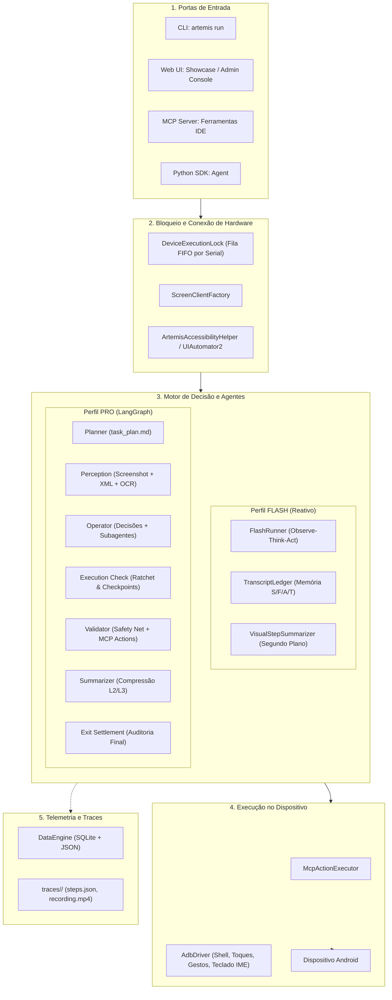

# ARTEMIS — Arquitetura, Fluxo de Dados e Guia de Engenharia

Este documento contém uma análise detalhada da arquitetura interna do repositório **ARTEMIS** (*Autonomous Multimodal Android Agent & Testing Framework*). O objetivo deste guia é fornecer uma referência técnica abrangente para desenvolvimento, depuração, controle de fluxo e customizações no sistema.

---

## Sumário

1. [Visão Geral](#1-visão-geral)
2. [Arquitetura e Fluxo de Dados de Ponta a Ponta](#2-arquitetura-e-fluxo-de-dados-de-ponta-a-ponta)
   - [2.1 Camadas de Ingresso](#21-camadas-de-ingresso)
   - [2.2 Bloqueio de Dispositivo e Conexão de Hardware](#22-bloqueio-de-dispositivo-e-conexão-de-hardware)
   - [2.3 Perfis de Execução: Flash vs. Pro](#23-perfis-de-execução-flash-vs-pro)
   - [2.4 Máquina de Estados e Memória de Contexto](#24-máquina-de-estados-e-memória-de-contexto)
   - [2.5 Atuação e Sessão MCP In-Process](#25-atuação-e-sessão-mcp-in-process)
   - [2.6 Telemetria e Persistência de Traces](#26-telemetria-e-persistência-de-traces)
3. [Chamada e Roteamento de Modelos LLM/VLM](#3-chamada-e-roteamento-de-modelos-llmvlm)
   - [3.1 Configuração Granular (`config/artemis.jsonc`)](#31-configuração-granular-configartemisjsonc)
   - [3.2 Router e Factory de Provedores](#32-router-e-factory-de-provedores)
   - [3.3 Resiliência, Circuit Breaker e Fallback](#33-resiliência-circuit-breaker-e-fallback)
   - [3.4 Token Metering e Caching](#34-token-metering-e-caching)
4. [Captura, Resolução e Qualidade de Imagens](#4-captura-resolução-e-qualidade-de-imagens)
   - [4.1 Onde os Screenshots são Gerados](#41-onde-os-screenshots-são-gerados)
   - [4.2 Formatação e Injeção no Prompt Multimodal](#42-formatação-e-injeção-no-prompt-multimodal)
   - [4.3 Guia Prático para Alterar a Resolução e Compressão](#43-guia-prático-para-alterar-a-resolução-e-compressão)
   - [4.4 Impacto no Sistema de Coordenadas](#44-impacto-no-sistema-de-coordenadas)
5. [Controle de Fluxo e Parada da Execução](#5-controle-de-fluxo-e-parada-da-execução)
   - [5.1 Seleção de Perfil (`flash` vs `pro`)](#51-seleção-de-perfil-flash-vs-pro)
   - [5.2 Limite de Turnos e Critérios de Conclusão](#52-limite-de-turnos-e-critérios-de-conclusão)
   - [5.3 Injeção de Instruções ao Vivo (`injected_instruction.json`)](#53-injeção-de-instruções-ao-vivo-injected_instructionjson)
   - [5.4 Sistema de Auditoria e Verificação (`Checker` & Safety Net)](#54-sistema-de-auditoria-e-verificação-checker--safety-net)
   - [5.5 Cancelamento Gracioso de Tarefas](#55-cancelamento-gracioso-de-tarefas)
6. [Mapeamento Completo da Estrutura de Diretórios](#6-mapeamento-completo-da-estrutura-de-diretórios)
7. [Boas Práticas e Dicas de Desenvolvimento](#7-boas-práticas-e-dicas-de-desenvolvimento)

---

## 1. Visão Geral

O **ARTEMIS** é uma plataforma desenhada para executar tarefas do cotidiano e fluxos complexos de teste automatizado em sistemas operacionais Android (telefones físicos e emuladores), interpretando a tela visualmente e interagindo com a interface gráfica da mesma forma que um usuário humano.

O sistema integra:
- **Suporte Multimodal Abrangente**: Modelos como Gemini (Google GenAI / Vertex AI), GPT-4o (OpenAI), Claude 3.5/3.7 (Anthropic), Grok (xAI) e provedores locais como Ollama e vLLM.
- **Protocolo MCP Nativo**: Um servidor Model Context Protocol integrado para comunicação bidirecional com ferramentas de desenvolvimento (Antigravity, Claude Code, Cursor, Windsurf).
- **Console Web Integrado (Showcase)**: Painel FastAPI + Angular para controle ao vivo, espelhamento de tela (via WebRTC/scrcpy) e replay interativo de execuções.
- **Dois Modos Operacionais**: Perfil **Flash** (loop reativo ultra-rápido de 3–5s por passo) e Perfil **Pro** (grafo de agentes com planejamento dinâmico, checagens e recuperação de falhas).

---

## 2. Arquitetura e Fluxo de Dados de Ponta a Ponta



### 2.1 Camadas de Ingresso
1. **CLI (`artemis run`)**: Processa argumentos via `typer` em `artemis/interfaces/cli/commands/run.py` e dispara `execute_task()`.
2. **MCP (`mcp_server`)**: Expõe ferramentas remotas (`mobile_run_task`, `mobile_manage_task`, `mobile_get_device_state`, etc.) para assistentes de codificação.
3. **Showcase Web Console (`apps/admin_console`)**: API FastAPI que gerencia sessões, streaming de tela e disparo de tarefas via HTTP/WebSocket.
4. **Python SDK (`artemis.sdk.Agent`)**: Permite rodar tarefas diretamente a partir de código Python.

### 2.2 Bloqueio de Dispositivo e Conexão de Hardware
- **`DeviceExecutionLock` (`artemis/runtime/device_lock.py`)**: Implementa um mecanismo de fila global estrita (FIFO) por ID serial do dispositivo ADB. Isso garante que múltiplas tarefas simultâneas não enviem comandos conflitantes para a mesma tela.
- **Detecção de Bloqueio Seguro**: O agente valida o estado de bloqueio (`dumpsys trust`). Se o dispositivo estiver bloqueado por PIN, senha ou padrão biométrico, a execução é abortada para evitar adivinhações inseguras de credenciais.
- **`ScreenClientFactory` (`artemis/clients/screen_client_factory.py`)**: Conecta-se prioritariamente ao APK local `ArtemisAccessibilityHelper` (porta HTTP mapeada via ADB reverse/forward) para dumps instantâneos de XML e screenshot unificado. Caso não esteja disponível, recorre ao `UIAutomator2`.

### 2.3 Perfis de Execução: Flash vs. Pro
A execução bifurca em `AgentBase._run_task()`:
- **Flash (`FlashRunner`)**:
  - Implementado em `artemis/agents/flash/runner.py`.
  - Executa um loop reativo linear: `Observar -> Pensar -> Agir`.
  - Histórico gerenciado pelo `TranscriptLedger` com compressão assíncrona de screenshots.
- **Pro (`LangGraph`)**:
  - Implementado em `artemis/graph/graph.py`.
  - Constrói uma máquina de estados com múltiplos nós (`planner`, `perception`, `operator`, `execution_check`, `validator`, `summarizer`, `exit_settlement`).

### 2.4 Máquina de Estados e Memória de Contexto
No perfil Pro, os dados trafegam pelo modelo Pydantic `State` (`artemis/graph/state.py`):
- `initial_goal`: Objetivo original do usuário.
- `latest_screenshot`, `operator_raw_data`, `latest_ui_hierarchy`: Percepção atual da tela.
- `structured_decisions`: Decisões estruturadas em JSON tomadas pelo Operador.
- `last_execution_result`: Resultado retornado pelo Validador.
- `operator_feedback`: Feedbacks cumulativos de auditoria e checagem.
- `injected_instruction`: Instruções dinâmicas enviadas pelo usuário em tempo real.

O `TranscriptLedger` organiza as mensagens em 4 regiões lógicas:
1. **Região S (Stable Prefix)**: Mensagem estática de sistema, idêntica durante toda a sessão (permite prompt caching).
2. **Região F (Frozen History)**: Histórico congelado e compactado em eras/marcos.
3. **Região A (Active Window)**: Histórico recente de turnos e chamadas de ferramentas.
4. **Região T (Current Tail)**: Bloco da observação atual (`# CURRENT OBSERVATION [T+mm:ss]`) com o screenshot mais recente e a hierarquia UI.

A compressão ocorre em 3 camadas:
- **L1 (Text Edge)**: Remove elementos efêmeros (listas de UI antigas, avisos de turno) após a conclusão do passo.
- **L2 (Image Edge)**: Substitui screenshots antigos por resumos textuais descritivos gerados em segundo plano pelo `VisualStepSummarizer`.
- **L3 (Chunking)**: Agrupa sequências inteiras de passos em cápsulas resumidas ao atingir limites de contexto.

### 2.5 Atuação e Sessão MCP In-Process
- As ações na tela são despachadas por `McpActionExecutor` (`artemis/mcp/action_executor.py`).
- Suporta toques (`tap`), toques duplos, pressões longas (`long_press`), arrasto/deslize (`swipe`), digitação (`type`), envio de teclas de hardware (`press_key`) e lançamento de aplicativos (`launch_app`).
- O servidor roda em processo (evitando problemas de subprocessos em plataformas como Windows).

### 2.6 Telemetria e Persistência de Traces
- Gerenciado pelo `DataEngine` (`artemis/data_engine/engine.py`).
- Cria o diretório `traces/<session_id>/` contendo:
  - `steps.json`: Histórico estruturado de cada turno, raciocínio, ferramentas e resultados.
  - `recording.mp4`: Gravação contínua em vídeo da tela capturada via `scrcpy`.
  - `status.json`: Metadados do status final da automação.

---

## 3. Chamada e Roteamento de Modelos LLM/VLM

### 3.1 Configuração Granular (`config/artemis.jsonc`)
O arquivo central de configuração permite parametrizar tanto o modelo global quanto modelos especializados por subagente:

```jsonc
{
  "default": {
    "provider": "google",
    "model": "gemini-2.5-flash",
    "timeout": 60.0,
    "fallback": {
      "provider": "openai",
      "model": "gpt-4o",
      "timeout": 60.0
    }
  },
  "nodes": {
    "planner": {
      "thinking_level": "high"
    },
    "operator": {
      "thinking_level": "medium",
      "include_thoughts": true
    },
    "object_detector": {
      // Requer modelos com raciocínio espacial para detecção sub-pixel
      "model": "gemini-robotics-er-2-preview"
    },
    "checker": {
      "thinking_level": "medium",
      "include_thoughts": true
    }
  }
}
```

### 3.2 Router e Factory de Provedores
Em `artemis/llm/router.py`:
- `ModelProvider`: Enum que normaliza provedores (`google`, `vertexai`, `openai`, `anthropic`, `openrouter`, `xai`, `ollama`, `vllm`, `custom`).
- `ModelFactory.get_model()`: Retorna instâncias cacheadas dos modelos LangChain correspondentes:
  - **Google**: `ChatGoogleGenerativeAI` (configurado com `thinking_budget`, `thinking_level` e desativação de filtros de conteúdo falsos-positivos).
  - **OpenAI**: `ChatOpenAI` (com suporte a `reasoning_effort` para modelos o-series).
  - **Anthropic**: `ChatAnthropic` (com suporte a `budget_tokens`).
  - **Ollama / vLLM / Local**: instanciados via `ChatOpenAI` apontando para o endpoint local (`OPENAI_BASE_URL` ou `http://localhost:8000/v1`).

### 3.3 Resiliência, Circuit Breaker e Fallback
Implementado em `artemis/services/llm.py`:
- **`RobustChatModelWrapper`**: Envolve todas as chamadas LangChain.
- **Circuit Breaker (`_ENDPOINT_BREAKER`)**: Caso um endpoint apresente 3 falhas consecutivas, abre o circuito por 30 segundos para evitar sobrecarga.
- **Classificação de Erros (`classify_failure`)**: Diferencia erros permanentes (ex: prompt inválido) de erros transitórios (erros 503, rate limit 429).
- **Fallback Automático (`with_fallback`)**: Quando as tentativas no modelo principal se esgotam, o sistema transfere a chamada imediatamente para o endpoint de contingência sem interromper a tarefa.

### 3.4 Token Metering e Caching
- O módulo `artemis/services/token_meter.py` intercepta metadados de resposta e contabiliza tokens de entrada, saída e reaproveitamento de cache (Prompt Caching do Gemini e Anthropic).

---

## 4. Captura, Resolução e Qualidade de Imagens

### 4.1 Onde os Screenshots são Gerados
Existem duas rotas principais para captura de tela:

1. **Accessibility Helper APK (Android 11+)**:
    - Arquivo Java: `packages/artemis-accessibility-helper/app/src/main/java/com/artemis/helper/HierarchyDumper.java` (linha ~286).
    - O hardware buffer é capturado diretamente e convertido em JPEG:
      ```java
      ByteArrayOutputStream baos = new ByteArrayOutputStream(bitmap.getWidth() * bitmap.getHeight() / 4);
      bitmap.compress(Bitmap.CompressFormat.JPEG, 80, baos);
      byte[] jpegBytes = baos.toByteArray();
      ```
    - A captura utiliza a resolução nativa do display com qualidade JPEG 80.

2. **Fallback ADB Screencap**:
    - Arquivo: `artemis/clients/accessibility_client.py` (linha ~321) e `third_party/mobile_use/clients/ui_automator_client.py` (linha ~150).
    - Executa `adb exec-out screencap -p` e comprime a imagem em Python:
      ```python
      def pil_to_base64(img: Image.Image, format: str = "JPEG", quality: int = 80) -> str:
          buffer = BytesIO()
          if format.upper() in ("JPEG", "JPG"):
              format = "JPEG"
              if img.mode in ("RGBA", "P"):
                  img = img.convert("RGB")
              img.save(buffer, format=format, quality=quality, optimize=True)
          else:
              img.save(buffer, format=format)
          return base64.b64encode(buffer.getvalue()).decode("utf-8")
      ```

### 4.2 Formatação e Injeção no Prompt Multimodal
Antes de enviar à LLM, a imagem codificada em base64 é montada no formato padrão de mensagem multimodal:
- **No FlashRunner** (`artemis/agents/flash/runner.py`, linha ~370):
  ```python
  img_b64 = base64.b64encode(img_bytes).decode("utf-8")
  blocks.append({"type": "text", "text": "--- Current Screenshot ---"})
  blocks.append({"type": "image_url", "image_url": {"url": f"data:image/jpeg;base64,{img_b64}"}})
  ```
- **No Pro Operator** (`artemis/agents/operator/prompts.py`, `ObservationPromptComponent`):
  ```python
  builder.add_human_content({
      "type": "image_url",
      "image_url": {"url": f"data:image/jpeg;base64,{latest_screenshot_b64}"},
  })
  ```

### 4.3 Guia Prático para Alterar a Resolução e Compressão

Caso deseje diminuir o consumo de tokens de visão ou aumentar a velocidade de resposta:

#### Opção A: Redimensionamento Proporcional via Python (Recomendado)
Você pode redimensionar a imagem antes da codificação base64 em `third_party/mobile_use/clients/ui_automator_client.py` ou diretamente na montagem do bloco em `artemis/agents/flash/runner.py` e `artemis/agents/operator/prompts.py`:

```python
import io
from PIL import Image

def resize_screenshot_bytes(img_bytes: bytes, max_dim: int = 1080, quality: int = 80) -> bytes:
    """Redimensiona o screenshot preservando a proporção de aspecto."""
    with Image.open(io.BytesIO(img_bytes)) as im:
        if max(im.size) > max_dim:
            im.thumbnail((max_dim, max_dim), Image.Resampling.LANCZOS)
        buf = io.BytesIO()
        if im.mode in ("RGBA", "P"):
            im = im.convert("RGB")
        im.save(buf, format="JPEG", quality=quality, optimize=True)
        return buf.getvalue()
```

#### Opção B: Alterar Parâmetro de Qualidade JPEG
Para reduzir o peso dos payloads sem alterar o número de pixels, ajuste o parâmetro `quality` de `80` para `60` ou `70` em `pil_to_base64()`.

#### Opção C: Adicionar Parâmetro `detail` para OpenAI / OpenRouter
Para modelos baseados na API da OpenAI, você pode especificar o modo de detalhe:
```python
{
    "type": "image_url",
    "image_url": {
        "url": f"data:image/jpeg;base64,{img_b64}",
        "detail": "low"  // ou "high"
    }
}
```

### 4.4 Impacto no Sistema de Coordenadas
O Artemis resolve alvos na tela através de:
1. **Índices da Árvore de Acessibilidade (`[n]`)**: O Operador decide clicar no elemento `[4]`. O Validador busca os limites desse elemento diretamente na hierarquia XML nativa.
2. **Coordenadas Normalizadas (`0..1000`)**: O Operador informa coordenadas relativas na escala `[x, y]` entre `0` e `1000`. O módulo `artemis/utils/coordinates.py` denormaliza multiplicando pela largura e altura físicas reportadas pelo dispositivo (`width` e `height`).

> [!IMPORTANT]
> Se você redimensionar apenas a imagem no payload do prompt mantendo a proporção de aspecto, o mapeamento de índices `[n]` e as coordenadas normalizadas `[0..1000]` continuam funcionando com precisão. **Nunca altere** os campos `width` e `height` originais armazenados no `controller` ou no `ScreenData`, pois eles devem refletir a resolução real do hardware Android.

---

## 5. Controle de Fluxo e Parada da Execução

```mermaid
flowchart TD
    Start([Início da Tarefa]) --> ModeCheck{Perfil?}
    
    %% Fluxo Flash
    ModeCheck -- Flash --> F_Observe[Captura Tela e XML]
    F_Observe --> F_Think[LLM: Observe-Think-Act]
    F_Think --> F_Act[McpActionExecutor Executa no Celular]
    F_Act --> F_CheckDone{Status == completed ou Max Turns?}
    F_CheckDone -- Não --> F_Observe
    F_CheckDone -- Sim --> Finalize([Finalizar e Gravar Traces])

    %% Fluxo Pro
    ModeCheck -- Pro --> P_Plan[Planner: task_plan.md]
    P_Plan --> P_Perceive[Perception: XML + Screenshot + Injected Instructions]
    P_Perceive --> P_Operate[Operator: Decisões e Subagentes]
    P_Operate --> P_Check[Execution Check: Ratchet e Checkpoints]
    P_Check --> P_Validate[Validator: Safety Net e Execução MCP]
    P_Validate --> P_Summarize[Summarizer: Atualiza Memória L2/L3]
    P_Summarize --> P_Gate{Todas as metas [x]?}
    P_Gate -- Não --> P_Perceive
    P_Gate -- Sim / Erro --> P_Exit[Exit Settlement: Auditoria Final]
    P_Exit --> P_Approved{Aprovado?}
    P_Approved -- Não (Tem tentativas) --> P_Perceive
    P_Approved -- Sim --> Finalize
```

### 5.1 Seleção de Perfil (`flash` vs `pro`)
- Pela linha de comando:
  ```bash
  uv run artemis run "Abra as Configurações e verifique o nível da bateria" --profile flash
  ```
- No arquivo `.env`:
  ```ini
  ARTEMIS_DEFAULT_PROFILE=flash
  ```

### 5.2 Limite de Turnos e Critérios de Conclusão
1. **Pela Meta Concluída**: No perfil Pro, o arquivo `task_plan.md` mantém a lista de submetas. Quando todas as metas principais recebem a marcação `[x]`, o nó `convergence_gate` encaminha o fluxo para o `exit_settlement`.
2. **Limite Numérico de Passos**:
   - Via CLI: `--max-steps <número>`.
   - No `artemis.jsonc`: `agent.flash.max_turns` (o padrão `0` significa passos ilimitados, já que o contexto é mantido estável pela compressão de histórico).
3. **Milestones Contínuos (`[Loop:continuous]`)**:
   - Planos que possuem a flag `[Loop:continuous]` continuam executando mesmo após todas as submetas estarem concluídas, até que um sinal externo de parada seja recebido (`user_stop_requested = True`).

### 5.3 Injeção de Instruções ao Vivo (`injected_instruction.json`)
O Artemis permite intervir na execução do agente sem precisar interrompê-lo:
1. Durante a execução, o nó `perception_node` verifica a existência do arquivo `injected_instruction.json` na raiz da pasta da sessão ativa.
2. Ao detectar o arquivo, ele carrega a instrução, remove o arquivo do disco para evitar repetições, e preenche `State.injected_instruction`.
3. O componente `InjectedInstructionPromptComponent` adiciona a instrução ao prompt do Operador no turno imediatamente seguinte.

### 5.4 Sistema de Auditoria e Verificação (`Checker` & Safety Net)
- **Pre-execution Safety Net (`ValidatorNode`)**: Antes de executar um toque na tela, o Validador avalia se as pré-condições visuais da tela coincidem com o esperado (via `precondition_pixel.py` e `precondition_xml.py`), evitando toques em telas erradas causados por atrasos de animação.
- **Auditoria de Checkpoints (`Checker`)**: Valida assincronamente as evidências de cada marco concluído no plano.
- **Níveis de Verificação (`--verification-level`)**:
   - `off`: Sem checagens extras.
   - `final`: Executa auditoria formal apenas na conclusão da meta principal.
   - `checkpoints`: Checa cada marco concluído durante o progresso.
   - `strict`: Encerra imediatamente a execução se um critério de verificação falhar (`assert_failure_policy: "halt"`).

### 5.5 Cancelamento Gracioso de Tarefas
O módulo `artemis/runtime/cancel_requests.py` observa marcadores de cancelamento de sessão:
- Quando o usuário solicita o cancelamento (via Web UI, MCP `mobile_manage_task` ou `Ctrl+C`), o runtime encerra os processos em execução, para e finaliza a gravação de vídeo via FFmpeg/scrcpy, compila os arquivos de traces e libera o lock do dispositivo no sistema.

---

## 6. Mapeamento Completo da Estrutura de Diretórios

```
artemis/
├── apps/
│   └── admin_console/           # Servidor FastAPI e painel Web Showcase (Angular)
├── artemis/
│   ├── agents/                  # Nós especializados de agentes
│   │   ├── checker/             # Auditoria pós-ação e validação de critérios
│   │   ├── diagnoser/           # Diagnóstico de erros com busca aterrada
│   │   ├── explorer/            # Localização de elementos visuais e candidatos de clique
│   │   ├── flash/               # Runner reativo leve e compressor de histórico
│   │   ├── log_analyzer/        # Leitor e analisador de Android Logcat
│   │   ├── object_detector/     # Detecção espacial e coordenadas sub-pixel
│   │   ├── operator/            # Agente principal de navegação e tomada de decisão
│   │   ├── planner/             # Decomposição de objetivos em task_plan.md
│   │   ├── summarizer/          # Resumos de contexto e histórico
│   │   ├── validator/           # Execução de ações MCP e Pixel Safety Net
│   │   └── video_analyzer/      # Análise temporal de gravações via scrcpy
│   ├── clients/                 # Conexões com o dispositivo (AccessibilityClient, ScreenClientFactory)
│   ├── config/                  # Modelos Pydantic de configuração e paths
│   ├── controllers/             # Controladores unificados de dispositivo (UnifiedMobileController)
│   ├── data_engine/             # Banco de dados de telemetria, sessões e traces
│   ├── drivers/                 # Drivers de baixo nível ADB, IME e gravação
│   ├── graph/                   # Grafo de estados LangGraph (state.py, graph.py, perception.py)
│   ├── interfaces/cli/          # Linha de comando Typer (run, ui, doctor, mcp, helper)
│   ├── llm/                     # Roteador de modelos, parsers estruturados e circuit breakers
│   ├── mcp/                     # Execução de ações no dispositivo in-process (McpActionExecutor)
│   ├── memory/                  # TranscriptLedger e compressão em camadas (S/F/A/T)
│   ├── runtime/                 # Fila de locks de dispositivo, monitoramento e daemons
│   ├── services/                # Wrapper resiliente de LLMs e Token Meter
│   └── utils/                   # Utilitários de coordenadas, visão computacional e OCR
├── config/
│   └── artemis.jsonc            # Configuração principal de modelos, subagentes e perfis
├── mcp_server/                  # Servidor MCP para integração com IDEs
├── packages/
│   └── artemis-accessibility-helper/  # Código fonte Java do APK de acessibilidade
└── traces/                      # Diretório de persistência de execuções e vídeos
```

---

## 7. Boas Práticas e Dicas de Desenvolvimento

1. **Desenvolvimento e Testes sem Consumo de Cotas**:
   Defina `ARTEMIS_FAKE_LLM=1` no arquivo `.env` para simular chamadas de IA instantaneamente sem conectar aos provedores pagos.
2. **Diagnóstico Rápido de Ambiente**:
   Execute `uv run artemis doctor` para validar conectividade ADB, binários auxiliares (scrcpy, ffmpeg) e credenciais de API configuradas.
3. **Adicionar Novas Ferramentas ao Agente**:
   - Defina a ferramenta em `artemis/tools/`.
   - Adicione o schema e permissões no `McpActionExecutor` (`artemis/mcp/action_executor.py`).
   - Registre a declaração de ferramenta em `artemis/agents/validator/tool_declarations.py` para torná-la visível ao Operador.
4. **Customização de Prompts**:
   Os prompts base do Operador estão centralizados em `artemis/agents/operator/prompts.py`. Componentes adicionais são injetados de forma modular via classes derivadas de `PromptComponent`.
