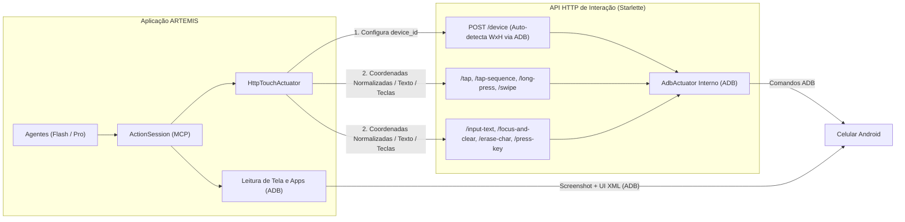

# Especificação Técnica: Camada de Interação Touch e Input via API HTTP no ARTEMIS

> [!IMPORTANT]
> **Diretrizes Principais para Implementação**:
> 1. **Preservação Integral de `capabilities()`**: O `HttpTouchActuator` **não** deve remover nenhuma capacidade (`input_text`, `press_key`, `erase_one_char` e `focus_and_clear_text` continuam ativas). Todas as interações de toque, texto e teclas serão roteadas via HTTP para a API.
> 2. **Configuração Dinâmica de Dispositivo (`POST /device`)**: A API deve expor uma rota para definir o `device_id` (serial ADB ou `ip:porta`). Ao receber o `device_id`, a API consulta o ADB (`adb -s <device_id> shell wm size`) para descobrir e armazenar automaticamente `screen_width` e `screen_height` do dispositivo.
> 3. **Payloads Enxutos com Coordenadas Normalizadas (`0..1000`)**: As rotas de ação (`/tap`, `/tap-sequence`, `/long-press`, `/swipe`, `/focus-and-clear`) não devem exigir `device_id`, `screen_width`, `screen_height` nem coordenadas absolutas (`x`, `y`) no corpo da requisição. O cliente envia apenas coordenadas normalizadas (`nx`, `ny`), e a API converte internamente para pixels usando as dimensões do dispositivo ativo.
> 4. **Rotas de Texto e Teclas via HTTP**: Incluir rotas dedicadas (`POST /input-text`, `POST /focus-and-clear`, `POST /erase-char`, `POST /press-key`) que hoje delegam ao ADB, permitindo que futuramente a API converta texto em toques de teclado virtual sem necessidade de alterar o ARTEMIS.
> 5. **Convenção de Código**: Todo o código-fonte, nomes de variáveis, docstrings, comentários e mensagens de log/erro devem ser escritos em **inglês**.

---

## 1. Arquitetura e Fluxo de Execução



---

## 2. Contrato das Rotas HTTP (`artemis/interfaces/touch_api/server.py`)

### 2.1. `GET /` e `GET /health`
Retorna o status de disponibilidade da API e o dispositivo atualmente configurado (se houver).
- **Response JSON (`200 OK`)**:
  ```json
  {
    "status": "ok",
    "service": "artemis-touch-api",
    "device": {
      "device_id": "emulator-5554",
      "screen_width": 1080,
      "screen_height": 2400
    }
  }
  ```

### 2.2. `POST /device`
Define o dispositivo alvo (serial ou `IP:porta`) e consulta suas dimensões reais via `adb -s <device_id> shell wm size` (considerando `Override size` se existir, ou `Physical size`).
- **Request JSON**:
  ```json
  {
    "device_id": "192.168.1.50:5555"
  }
  ```
- **Response JSON (`200 OK`)**:
  ```json
  {
    "ok": true,
    "device_id": "192.168.1.50:5555",
    "screen_width": 1080,
    "screen_height": 2400,
    "message": "Device configured: 192.168.1.50:5555 (1080x2400).",
    "error": null
  }
  ```

### 2.3. `POST /tap` (usado por `click`)
- **Request JSON**:
  ```json
  {
    "nx": 500,
    "ny": 500,
    "times": 1,
    "delay_ms": 100
  }
  ```
- **Response JSON (`200 OK`)**:
  ```json
  {
    "ok": true,
    "message": "Tapped at [500, 500] (normalized).",
    "error": null
  }
  ```

### 2.4. `POST /tap-sequence` (usado por `click_sequence`)
- **Request JSON**:
  ```json
  {
    "points": [
      {"nx": 185, "ny": 750},
      {"nx": 500, "ny": 750}
    ],
    "delay_ms": 50
  }
  ```
- **Response JSON (`200 OK`)**:
  ```json
  {
    "ok": true,
    "message": "Tapped in sequence at [185, 750]; [500, 750] (normalized).",
    "error": null
  }
  ```

### 2.5. `POST /long-press` (usado por `long_press`)
- **Request JSON**:
  ```json
  {
    "nx": 500,
    "ny": 500,
    "duration_ms": 1000
  }
  ```
- **Response JSON (`200 OK`)**:
  ```json
  {
    "ok": true,
    "message": "Long-pressed at [500, 500] (normalized) for 1000ms.",
    "error": null
  }
  ```

### 2.6. `POST /swipe` (usado por `swipe`)
- **Request JSON**:
  ```json
  {
    "start_nx": 500,
    "start_ny": 750,
    "end_nx": 500,
    "end_ny": 250,
    "duration_ms": 400
  }
  ```
- **Response JSON (`200 OK`)**:
  ```json
  {
    "ok": true,
    "message": "Swiped from [500, 750] to [500, 250] (normalized).",
    "error": null
  }
  ```

### 2.7. `POST /input-text` (usado por `input_text`)
- **Request JSON**:
  ```json
  {
    "text": "Hello World"
  }
  ```
- **Response JSON (`200 OK`)**:
  ```json
  {
    "ok": true,
    "message": "Input text 'Hello World'.",
    "error": null
  }
  ```

### 2.8. `POST /focus-and-clear` (usado por `focus_and_clear_text`)
- **Request JSON**:
  ```json
  {
    "nx": 450,
    "ny": 300
  }
  ```
- **Response JSON (`200 OK`)**:
  ```json
  {
    "ok": true,
    "message": "Focused at [450, 300] and cleared text.",
    "error": null
  }
  ```

### 2.9. `POST /erase-char` (usado por `erase_one_char`)
- **Request JSON**:
  ```json
  {
    "times": 1
  }
  ```
- **Response JSON (`200 OK`)**:
  ```json
  {
    "ok": true,
    "message": "Erased character.",
    "error": null
  }
  ```

### 2.10. `POST /press-key` (usado por `press_key`)
- **Request JSON**:
  ```json
  {
    "key": "BACK"
  }
  ```
- **Response JSON (`200 OK`)**:
  ```json
  {
    "ok": true,
    "message": "Pressed key BACK.",
    "error": null
  }
  ```

---

## 3. Arquivos a Serem Criados ou Modificados

### 3.1. `artemis/interfaces/touch_api/server.py` *(CRIAR / ATUALIZAR)*
Implementa a aplicação Starlette ASGI com os modelos Pydantic e rotas acima.

```python
# Copyright 2026 Google LLC
#
# Licensed under the Apache License, Version 2.0 (the "License");
# you may not use this file except in compliance with the License.
# You may obtain a copy of the License at
#
#     http://www.apache.org/licenses/LICENSE-2.0
#
# Unless required by applicable law or agreed to in writing, software
# distributed under the License is distributed on an "AS IS" BASIS,
# WITHOUT WARRANTIES OR CONDITIONS OF ANY KIND, either express or implied.
# See the License for the specific language governing permissions and
# limitations under the License.

"""HTTP Touch & Input API server backed by ADB."""

import asyncio
import json
import os
import re
from typing import Any

from pydantic import BaseModel, Field, ValidationError
from starlette.applications import Starlette
from starlette.requests import Request
from starlette.responses import JSONResponse
from starlette.routing import Route

from artemis.config.settings import settings
from artemis.context import ArtemisContext, DeviceContext, DevicePlatform
from artemis.controllers.unified_controller import UnifiedMobileController
from artemis.mcp.action_types import ActionResult
from artemis.mcp.actuators.adb import AdbActuator
from artemis.platform import platform
from third_party.mobile_use.utils.logger import get_logger

logger = get_logger(__name__)

__all__ = [
    "DeviceConfigRequest",
    "DeviceConfigResponse",
    "EraseCharRequest",
    "FocusAndClearRequest",
    "InputTextRequest",
    "LongPressRequest",
    "PressKeyRequest",
    "SwipeRequest",
    "TapPoint",
    "TapRequest",
    "TapSequenceRequest",
    "TouchActionResponse",
    "app",
    "create_touch_api_app",
]

_WM_SIZE_PATTERN = re.compile(r"(\d+)x(\d+)")


class DeviceConfigRequest(BaseModel):
    """Request payload for ``POST /device``."""

    device_id: str = Field(..., min_length=1, description="ADB serial number or IP:port")


class DeviceConfigResponse(BaseModel):
    """Response payload for ``POST /device``."""

    ok: bool
    device_id: str
    screen_width: int
    screen_height: int
    message: str
    error: str | None = None


class TapRequest(BaseModel):
    """Request payload for ``POST /tap``."""

    nx: int = Field(..., ge=0, le=1000)
    ny: int = Field(..., ge=0, le=1000)
    times: int = Field(default=1, ge=1)
    delay_ms: int = Field(default=100, ge=0)


class TapPoint(BaseModel):
    """Single normalized point in a ``POST /tap-sequence`` request."""

    nx: int = Field(..., ge=0, le=1000)
    ny: int = Field(..., ge=0, le=1000)


class TapSequenceRequest(BaseModel):
    """Request payload for ``POST /tap-sequence``."""

    points: list[TapPoint] = Field(..., min_length=1)
    delay_ms: int = Field(default=50, ge=0)


class LongPressRequest(BaseModel):
    """Request payload for ``POST /long-press``."""

    nx: int = Field(..., ge=0, le=1000)
    ny: int = Field(..., ge=0, le=1000)
    duration_ms: int = Field(default=1000, ge=1)


class SwipeRequest(BaseModel):
    """Request payload for ``POST /swipe``."""

    start_nx: int = Field(..., ge=0, le=1000)
    start_ny: int = Field(..., ge=0, le=1000)
    end_nx: int = Field(..., ge=0, le=1000)
    end_ny: int = Field(..., ge=0, le=1000)
    duration_ms: int = Field(default=400, ge=1)


class InputTextRequest(BaseModel):
    """Request payload for ``POST /input-text``."""

    text: str = Field(..., min_length=1)


class FocusAndClearRequest(BaseModel):
    """Request payload for ``POST /focus-and-clear``."""

    nx: int = Field(..., ge=0, le=1000)
    ny: int = Field(..., ge=0, le=1000)


class EraseCharRequest(BaseModel):
    """Request payload for ``POST /erase-char``."""

    times: int = Field(default=1, ge=1)


class PressKeyRequest(BaseModel):
    """Request payload for ``POST /press-key``."""

    key: str = Field(..., min_length=1)


class TouchActionResponse(BaseModel):
    """Standard JSON response returned by all action endpoints."""

    ok: bool
    message: str
    error: str | None = None


async def _query_adb_screen_size(device_id: str) -> tuple[int, int]:
    """Queries ADB for the active screen resolution (Override or Physical size)."""
    cmd = ["adb"]
    if device_id and device_id != "default":
        cmd.extend(["-s", device_id])
    cmd.extend(["shell", "wm", "size"])

    proc = await asyncio.create_subprocess_exec(
        *cmd,
        stdout=asyncio.subprocess.PIPE,
        stderr=asyncio.subprocess.PIPE,
    )
    stdout, stderr = await proc.communicate()
    output = stdout.decode("utf-8", errors="replace").strip()

    if proc.returncode != 0:
        err_msg = stderr.decode("utf-8", errors="replace").strip() or output
        raise RuntimeError(f"Failed to query screen size for '{device_id}': {err_msg}")

    matches = _WM_SIZE_PATTERN.findall(output)
    if not matches:
        raise RuntimeError(f"Could not parse 'wm size' output for '{device_id}': {output}")

    width_str, height_str = matches[-1]
    return int(width_str), int(height_str)


def _build_context(
    device_id: str | None = None,
    width: int = 1080,
    height: int = 2400,
) -> ArtemisContext:
    serial = (
        device_id
        or os.environ.get("ADB_DEVICE_SERIAL")
        or getattr(settings, "ADB_DEVICE_SERIAL", None)
        or "default"
    )
    return ArtemisContext(
        trace_id="touch-api-server",
        device=DeviceContext(
            host_platform=platform.os_type.name,
            mobile_platform=DevicePlatform.ANDROID,
            device_id=str(serial),
            device_width=width,
            device_height=height,
        ),
    )


def _action_result_to_response(res: ActionResult) -> JSONResponse:
    body = TouchActionResponse(
        ok=res.ok,
        message=res.message,
        error=None if res.ok else (res.detail or res.message),
    )
    status_code = 200 if res.ok else 500
    return JSONResponse(body.model_dump(), status_code=status_code)


def _validation_error_response(exc: Exception) -> JSONResponse:
    return JSONResponse(
        TouchActionResponse(ok=False, message=str(exc), error=str(exc)).model_dump(),
        status_code=422,
    )


def create_touch_api_app(
    actuator: AdbActuator | None = None,
    controller: UnifiedMobileController | None = None,
    ctx: ArtemisContext | None = None,
) -> Starlette:
    """Creates an ASGI application serving the ADB-backed touch and input routes."""
    state_holder: dict[str, Any] = {
        "actuator": actuator,
        "controller": controller,
        "ctx": ctx,
    }

    async def _get_actuator() -> AdbActuator:
        act = state_holder["actuator"]
        if act is None:
            runtime_ctx = state_holder["ctx"]
            if runtime_ctx is None:
                default_serial = (
                    os.environ.get("ADB_DEVICE_SERIAL")
                    or getattr(settings, "ADB_DEVICE_SERIAL", None)
                    or "default"
                )
                try:
                    w, h = await _query_adb_screen_size(str(default_serial))
                except Exception as exc:
                    logger.warning("Falling back to 1080x2400 screen size: %s", exc)
                    w, h = 1080, 2400
                runtime_ctx = _build_context(device_id=str(default_serial), width=w, height=h)
                state_holder["ctx"] = runtime_ctx

            act = AdbActuator(runtime_ctx, controller=state_holder["controller"])
            state_holder["actuator"] = act
        return act

    async def health_endpoint(_request: Request) -> JSONResponse:
        current_ctx: ArtemisContext | None = state_holder.get("ctx")
        device_info = None
        if current_ctx and current_ctx.device:
            device_info = {
                "device_id": current_ctx.device.device_id,
                "screen_width": current_ctx.device.device_width,
                "screen_height": current_ctx.device.device_height,
            }
        return JSONResponse(
            {
                "status": "ok",
                "service": "artemis-touch-api",
                "device": device_info,
            }
        )

    async def set_device_endpoint(request: Request) -> JSONResponse:
        try:
            payload = await request.json()
            req = DeviceConfigRequest.model_validate(payload)
        except (json.JSONDecodeError, ValidationError, ValueError) as exc:
            return _validation_error_response(exc)

        try:
            width, height = await _query_adb_screen_size(req.device_id)
        except Exception as exc:
            body = DeviceConfigResponse(
                ok=False,
                device_id=req.device_id,
                screen_width=0,
                screen_height=0,
                message=f"Failed to query device '{req.device_id}'.",
                error=str(exc),
            )
            return JSONResponse(body.model_dump(), status_code=500)

        new_ctx = _build_context(device_id=req.device_id, width=width, height=height)
        state_holder["ctx"] = new_ctx

        act: AdbActuator | None = state_holder["actuator"]
        if act is not None:
            act.ctx = new_ctx
        else:
            state_holder["actuator"] = AdbActuator(
                new_ctx, controller=state_holder["controller"]
            )

        body = DeviceConfigResponse(
            ok=True,
            device_id=req.device_id,
            screen_width=width,
            screen_height=height,
            message=f"Device configured: {req.device_id} ({width}x{height}).",
        )
        return JSONResponse(body.model_dump(), status_code=200)

    async def tap_endpoint(request: Request) -> JSONResponse:
        try:
            payload = await request.json()
            req = TapRequest.model_validate(payload)
        except (json.JSONDecodeError, ValidationError, ValueError) as exc:
            return _validation_error_response(exc)
        act = await _get_actuator()
        res = await act.click(req.nx, req.ny, times=req.times, delay_ms=req.delay_ms)
        return _action_result_to_response(res)

    async def tap_sequence_endpoint(request: Request) -> JSONResponse:
        try:
            payload = await request.json()
            req = TapSequenceRequest.model_validate(payload)
        except (json.JSONDecodeError, ValidationError, ValueError) as exc:
            return _validation_error_response(exc)
        act = await _get_actuator()
        points = [(pt.nx, pt.ny) for pt in req.points]
        res = await act.click_sequence(points, delay_ms=req.delay_ms)
        return _action_result_to_response(res)

    async def long_press_endpoint(request: Request) -> JSONResponse:
        try:
            payload = await request.json()
            req = LongPressRequest.model_validate(payload)
        except (json.JSONDecodeError, ValidationError, ValueError) as exc:
            return _validation_error_response(exc)
        act = await _get_actuator()
        res = await act.long_press(req.nx, req.ny, duration_ms=req.duration_ms)
        return _action_result_to_response(res)

    async def swipe_endpoint(request: Request) -> JSONResponse:
        try:
            payload = await request.json()
            req = SwipeRequest.model_validate(payload)
        except (json.JSONDecodeError, ValidationError, ValueError) as exc:
            return _validation_error_response(exc)
        act = await _get_actuator()
        res = await act.swipe(
            start=(req.start_nx, req.start_ny),
            end=(req.end_nx, req.end_ny),
            duration_ms=req.duration_ms,
        )
        return _action_result_to_response(res)

    async def input_text_endpoint(request: Request) -> JSONResponse:
        try:
            payload = await request.json()
            req = InputTextRequest.model_validate(payload)
        except (json.JSONDecodeError, ValidationError, ValueError) as exc:
            return _validation_error_response(exc)
        act = await _get_actuator()
        res = await act.input_text(req.text)
        return _action_result_to_response(res)

    async def focus_and_clear_endpoint(request: Request) -> JSONResponse:
        try:
            payload = await request.json()
            req = FocusAndClearRequest.model_validate(payload)
        except (json.JSONDecodeError, ValidationError, ValueError) as exc:
            return _validation_error_response(exc)
        act = await _get_actuator()
        res = await act.focus_and_clear_text(req.nx, req.ny)
        return _action_result_to_response(res)

    async def erase_char_endpoint(request: Request) -> JSONResponse:
        try:
            payload = await request.json() if await request.body() else {}
            req = EraseCharRequest.model_validate(payload)
        except (json.JSONDecodeError, ValidationError, ValueError) as exc:
            return _validation_error_response(exc)
        act = await _get_actuator()
        res = ActionResult(ok=True, message="No characters erased.")
        for _ in range(req.times):
            res = await act.erase_one_char()
            if not res.ok:
                break
        return _action_result_to_response(res)

    async def press_key_endpoint(request: Request) -> JSONResponse:
        try:
            payload = await request.json()
            req = PressKeyRequest.model_validate(payload)
        except (json.JSONDecodeError, ValidationError, ValueError) as exc:
            return _validation_error_response(exc)
        act = await _get_actuator()
        res = await act.press_key(req.key)
        return _action_result_to_response(res)

    routes = [
        Route("/", health_endpoint, methods=["GET"]),
        Route("/health", health_endpoint, methods=["GET"]),
        Route("/device", set_device_endpoint, methods=["POST"]),
        Route("/tap", tap_endpoint, methods=["POST"]),
        Route("/tap-sequence", tap_sequence_endpoint, methods=["POST"]),
        Route("/long-press", long_press_endpoint, methods=["POST"]),
        Route("/swipe", swipe_endpoint, methods=["POST"]),
        Route("/input-text", input_text_endpoint, methods=["POST"]),
        Route("/focus-and-clear", focus_and_clear_endpoint, methods=["POST"]),
        Route("/erase-char", erase_char_endpoint, methods=["POST"]),
        Route("/press-key", press_key_endpoint, methods=["POST"]),
    ]
    return Starlette(routes=routes)


app = create_touch_api_app()


def main() -> None:
    """Runs the ADB Touch HTTP API server using Uvicorn."""
    import uvicorn

    host = os.environ.get("TOUCH_API_HOST", "127.0.0.1")
    port = int(os.environ.get("TOUCH_API_PORT", "8001"))
    uvicorn.run(app, host=host, port=port)


if __name__ == "__main__":
    main()
```

---

### 3.2. `artemis/mcp/actuators/http_touch.py` *(CRIAR)*
Implementa `HttpTouchActuator` herdando de `AdbActuator`.
- **Importante**: Não sobrescrever `capabilities()`, mantendo todas as tools do `AdbActuator` habilitadas.
- Sincroniza automaticamente o `device_id` do contexto na API via `POST /device` antes da primeira ação (ou se o `device_id` mudar).

```python
# Copyright 2026 Google LLC
#
# Licensed under the Apache License, Version 2.0 (the "License");
# you may not use this file except in compliance with the License.
# You may obtain a copy of the License at
#
#     http://www.apache.org/licenses/LICENSE-2.0
#
# Unless required by applicable law or agreed to in writing, software
# distributed under the License is distributed on an "AS IS" BASIS,
# WITHOUT WARRANTIES OR CONDITIONS OF ANY KIND, either express or implied.
# See the License for the specific language governing permissions and
# limitations under the License.

"""HTTP-backed Touch and Input Actuator for ARTEMIS."""

from collections.abc import Sequence
from typing import Any

import httpx

from artemis.config.settings import settings
from artemis.context import ArtemisContext
from artemis.controllers.unified_controller import UnifiedMobileController
from artemis.mcp.action_types import ActionResult
from artemis.mcp.actuators.adb import AdbActuator


class HttpTouchActuator(AdbActuator):
    """Actuator that routes touch, text, and key actions through the HTTP Touch API.

    Screen observation (screenshots, UI hierarchy) and app management remain
    handled directly via ADB through :class:`AdbActuator`.
    """

    def __init__(
        self,
        ctx: ArtemisContext,
        controller: UnifiedMobileController | None = None,
        base_url: str | None = None,
        timeout_s: float | None = None,
        client: httpx.AsyncClient | None = None,
    ) -> None:
        super().__init__(ctx, controller=controller)
        self.base_url = (
            base_url
            or getattr(settings, "ARTEMIS_TOUCH_API_URL", "http://127.0.0.1:8001")
        ).rstrip("/")
        self.timeout_s = timeout_s or float(
            getattr(settings, "ARTEMIS_TOUCH_API_TIMEOUT_S", 30.0)
        )
        self._external_client = client
        self._synced_device_id: str | None = None

    async def _post(self, path: str, payload: dict[str, Any]) -> ActionResult:
        url = f"{self.base_url}{path}"
        try:
            if self._external_client is not None:
                response = await self._external_client.post(
                    url, json=payload, timeout=self.timeout_s
                )
            else:
                async with httpx.AsyncClient(timeout=self.timeout_s) as client:
                    response = await client.post(url, json=payload)

            data = response.json()
            ok = bool(data.get("ok", response.is_success))
            message = str(data.get("message", ""))
            error = data.get("error")
            return ActionResult(
                ok=ok,
                message=message or (error or f"HTTP {response.status_code}"),
                detail=error,
            )
        except Exception as exc:
            return ActionResult(
                ok=False,
                message=f"HTTP Touch API request to {path} failed: {exc}",
                detail=str(exc),
            )

    async def _ensure_device_configured(self) -> ActionResult | None:
        device_id = self.ctx.device.device_id if (self.ctx and self.ctx.device) else None
        if not device_id or device_id == "default":
            return None
        if self._synced_device_id == device_id:
            return None

        res = await self._post("/device", {"device_id": device_id})
        if res.ok:
            self._synced_device_id = device_id
            return None
        return res

    async def configure_device(self, device_id: str) -> ActionResult:
        """Explicitly configures the target device on the Touch API server."""
        res = await self._post("/device", {"device_id": device_id})
        if res.ok:
            self._synced_device_id = device_id
            if self.ctx and self.ctx.device:
                self.ctx.device.device_id = device_id
        return res

    async def click(
        self,
        x: int,
        y: int,
        times: int = 1,
        delay_ms: int = 100,
    ) -> ActionResult:
        if err := await self._ensure_device_configured():
            return err
        return await self._post(
            "/tap",
            {"nx": x, "ny": y, "times": times, "delay_ms": delay_ms},
        )

    async def click_sequence(
        self,
        points: Sequence[tuple[int, int]],
        delay_ms: int = 50,
    ) -> ActionResult:
        if err := await self._ensure_device_configured():
            return err
        serialized_points = [{"nx": px, "ny": py} for px, py in points]
        return await self._post(
            "/tap-sequence",
            {"points": serialized_points, "delay_ms": delay_ms},
        )

    async def long_press(
        self,
        x: int,
        y: int,
        duration_ms: int = 1000,
    ) -> ActionResult:
        if err := await self._ensure_device_configured():
            return err
        return await self._post(
            "/long-press",
            {"nx": x, "ny": y, "duration_ms": duration_ms},
        )

    async def swipe(
        self,
        start: tuple[int, int],
        end: tuple[int, int],
        duration_ms: int = 400,
    ) -> ActionResult:
        if err := await self._ensure_device_configured():
            return err
        return await self._post(
            "/swipe",
            {
                "start_nx": start[0],
                "start_ny": start[1],
                "end_nx": end[0],
                "end_ny": end[1],
                "duration_ms": duration_ms,
            },
        )

    async def input_text(self, text: str) -> ActionResult:
        if err := await self._ensure_device_configured():
            return err
        return await self._post("/input-text", {"text": text})

    async def focus_and_clear_text(self, x: int, y: int) -> ActionResult:
        if err := await self._ensure_device_configured():
            return err
        return await self._post("/focus-and-clear", {"nx": x, "ny": y})

    async def erase_one_char(self) -> ActionResult:
        if err := await self._ensure_device_configured():
            return err
        return await self._post("/erase-char", {"times": 1})

    async def press_key(self, key: str) -> ActionResult:
        if err := await self._ensure_device_configured():
            return err
        return await self._post("/press-key", {"key": key})
```

---

### 3.3. `artemis/config/settings.py` *(MODIFICAR)*
Adicionar as configurações de ambiente para seleção do atuador e URL da API HTTP:
- `ARTEMIS_ACTUATOR_BACKEND: str = "adb"` (valores suportados: `"adb"` ou `"http"`)
- `ARTEMIS_TOUCH_API_URL: str = "http://127.0.0.1:8001"`
- `ARTEMIS_TOUCH_API_TIMEOUT_S: float = 30.0`

---

### 3.4. `artemis/mcp/actuators/__init__.py`, `artemis/mcp/action_session.py` e `artemis/mcp/action_executor.py` *(MODIFICAR)*
1. Exportar `HttpTouchActuator` e uma função factory `create_actuator(ctx: ArtemisContext, controller: UnifiedMobileController | None = None) -> Actuator` em `artemis/mcp/actuators/__init__.py`.
2. Quando `settings.ARTEMIS_ACTUATOR_BACKEND.lower() == "http"`, `create_actuator` deve retornar uma instância de `HttpTouchActuator(ctx, controller=controller)`. Caso contrário, retorna `AdbActuator(ctx, controller=controller)`.
3. Atualizar `ActionSession` e `ActionExecutor` para utilizarem `create_actuator` por padrão quando um atuador não for injetado explicitamente.

---

### 3.5. `tests/unit/mcp/test_http_touch_actuator.py` *(CRIAR)*
Implementar testes unitários herméticos usando `httpx.ASGITransport(app=create_touch_api_app(...))`:
1. **Teste de Configuração de Dispositivo (`POST /device`)**:
   - Mockar `_query_adb_screen_size` retornando `(1440, 3200)` para um `device_id` (ex: `"192.168.1.50:5555"`).
   - Verificar se a resposta retorna `200 OK` com `screen_width=1440` e `screen_height=3200` e atualiza o contexto interno da API.
2. **Teste de Sincronização Automática no `HttpTouchActuator`**:
   - Ao executar `await actuator.click(500, 500)` com `ctx.device.device_id = "emulator-5554"`, verificar se `POST /device` é invocado uma única vez antes de `POST /tap`.
3. **Teste das Rotas de Toque (`/tap`, `/tap-sequence`, `/long-press`, `/swipe`)**:
   - Garantir que apenas coordenadas normalizadas (`nx`, `ny`) são enviadas no payload e delegadas corretamente ao `AdbActuator` subjacente.
4. **Teste das Rotas de Texto e Teclas (`/input-text`, `/focus-and-clear`, `/erase-char`, `/press-key`)**:
   - Validar que `input_text`, `focus_and_clear_text`, `erase_one_char` e `press_key` continuam presentes em `actuator.capabilities()` e funcionam de ponta a ponta via HTTP.
5. **Teste de Validação de Manifesto**:
   - Validar `validate_actuator(actuator)` garantindo conformidade com o protocolo `Actuator`.